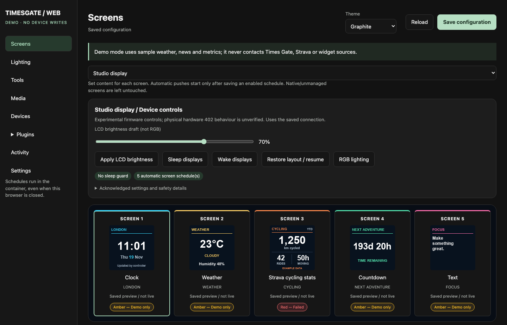
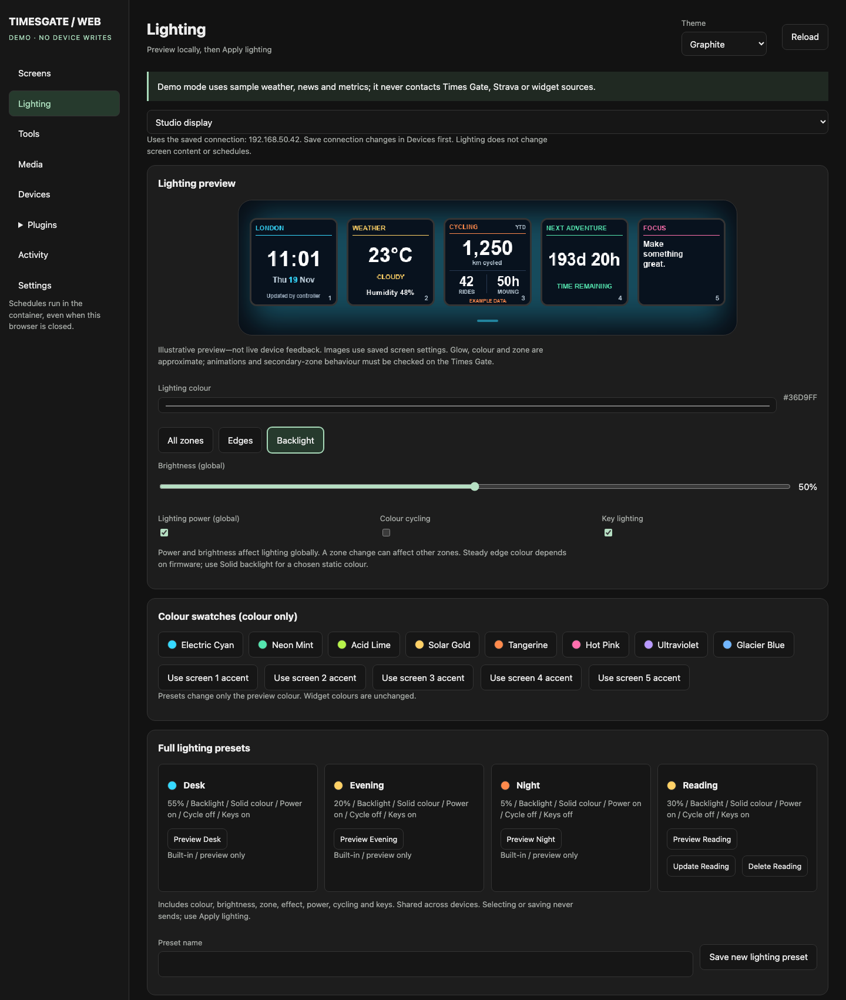
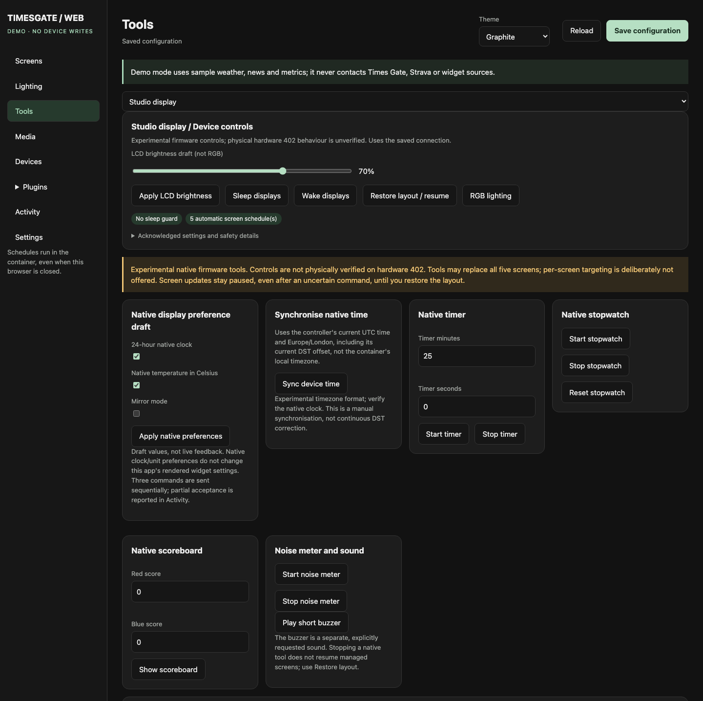
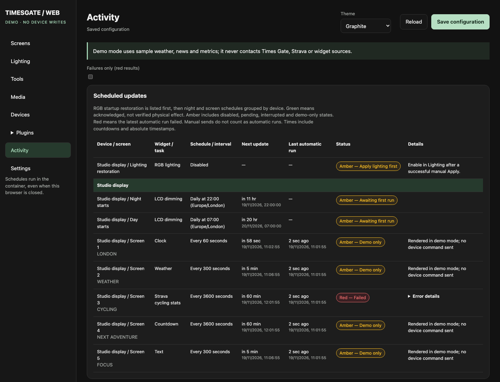

# Timesgate Web

A self-hosted web controller for Divoom Times Gate displays. Manage devices,
design screens, schedule updates and control lighting from your browser.
Run it on your NAS with Docker Compose; no desktop app is required.

[Docker Compose setup](docs/GUIDE.md#start-with-docker-compose) |
[OpenMediaVault guide](docs/OPENMEDIAVAULT.md) |
[More screenshots](#screenshots) |
[Detailed guide](docs/GUIDE.md)

*Actual application screenshot in demo mode. Screen images are generated previews,
not photographs or live device feedback.*

## Features

- **Five screens, one workspace:** up to ten devices, a compact overview and one
  focused editor per selected screen.
- **Widgets and media:** images/GIFs, clocks, text, weather, countdowns, RSS/Atom,
  custom layered designs and Strava cycling totals in metric or imperial units.
- **Scheduling and visibility:** interval, daily and clock-minute updates;
  grouped/filterable Activity with coloured RAG results and relative/absolute times.
- **RGB lighting:** zone-aware effects, colour swatches, full saved presets and an
  illustrative five-screen preview. Preview before Apply; startup restoration is opt-in.
- **Experimental device controls:** LCD brightness, sleep/wake, timezone-aware night
  schedules, native preferences, timer, stopwatch, scoreboard, noise meter,
  buzzer and diagnostics.
- **Make it yours:** four UI themes and eight widget accent colours.
- **Self-hosted persistence:** one administrator login, settings in SQLite and
  separate private data and device-media storage.

Hardware 402 is supported; hardware 400 routing is included but awaits physical
testing. Widgets are rendered images, not device-native faces.
Native controls are experimental and unverified on physical hardware 402.
Sleep guards and native-tool pauses block screen uploads until wake/resume.
RGB effects also depend on device firmware.

## Getting started

Docker Compose is the recommended deployment:

1. Copy [`.env.example`](.env.example) to `.env` and configure application/media
   URLs, ports and persistent storage.
2. Follow the [Docker Compose setup](docs/GUIDE.md#start-with-docker-compose)
   to prepare storage, start the services and create your administrator account.
3. Add a device, preview a screen and send a test image before enabling schedules.

For **OpenMediaVault 8 / ARM64**, use the
[OMV deployment guide](docs/OPENMEDIAVAULT.md).

For a device-free demo, follow the
[local development instructions](docs/GUIDE.md#local-development-no-docker)
and open **http://localhost:8080**.

## Screenshots

These captures use an isolated demo with sample data and a fictional device
address. No real device commands are sent. Strava previews show example figures;
sending Strava content still requires real cached statistics.

<strong>RGB lighting and full presets</strong>

Preview colours and zones, then explicitly Apply. Saved presets include brightness,
effect, power, colour cycling and key lighting, not just colour.

<strong>Device controls and native tools</strong>

Native controls are experimental. Tool takeover pauses automatic screen uploads
until you choose **Restore layout / resume**.

<strong>Activity, schedules and RAG results</strong>

Restoration appears first, followed by schedules grouped by device. Demo-only runs
are amber; the sample Strava failure reflects missing cached statistics, not a
device write.

## Deployment essentials

- Use HTTPS for administration outside localhost.
- Keep device media on its separate **HTTP** service, reachable by the device
  and **not protected by a login page**. Media URLs are unauthenticated; restrict
  access to your trusted network.
- Protect persistent storage and backups: device and Strava credentials are
  stored unencrypted.
- Run one controller process with one worker; multiple replicas are unsupported.

## Documentation

The [detailed guide](docs/GUIDE.md) covers setup, login and account recovery,
scheduling, widgets, Strava, privacy, development and validation limitations.

Container builds, OMV/ARM64 deployment and end-to-end NAS/device/Strava OAuth
verification still need validation on the deployment host.
